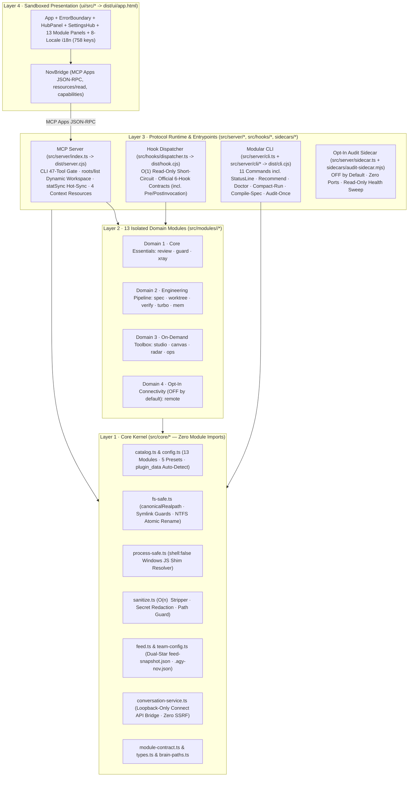

# agy-NOV System Architecture

`agy-NOV` is engineered as a **strictly layered, modular, 100% native** plugin for **Google Antigravity 2.0 (Desktop / CLI / IDE)**. Every layer obeys one-way dependency rules, zero ASAR/CDP host patching, zero token overhead when modules are OFF, and complete OS portability across macOS, Windows, and Linux.

---

## 1. Layered Dependency Model



### Unidirectional Dependency Rules (Enforced by `test/architecture-hygiene.test.ts`)

| Layer | Directory | Allowed Imports | Forbidden Imports |
| :--- | :--- | :--- | :--- |
| **Layer 1 · Core Kernel** | `src/core/*` | Node built-ins + `src/core/*` | `src/modules/*`, `src/server/*`, `src/hooks/*`, `ui/*` |
| **Layer 2 · Domain Modules** | `src/modules/<id>/*` | `src/core/*` + own module submodules (`src/modules/<id>/*`) + allowlisted cross-module bridge (`src/modules/spec/archive.ts -> src/modules/mem/store.ts` gated by live `cfg.modules.mem`, and type-only `src/modules/spec/types.ts -> src/modules/mem/types.ts`) | `src/server/*`, `src/hooks/*`, `ui/*`, any unapproved cross-module import |
| **Layer 3 · Protocol Runtime** | `src/server/*`, `src/hooks/*`, `sidecars/*` | `src/core/*`, `src/modules/*`, MCP SDK | `ui/*` |
| **Layer 4 · Presentation** | `ui/src/*` | React, `@modelcontextprotocol/ext-apps`, type-only imports from `src/core/*` | Node built-ins (`node:fs`, `node:child_process`, etc.) |

---

## 2. Repository Map

```text
agy-NOV/
├── plugin.json                  # Official Antigravity plugin manifest (strictly official keys only)
├── mcp_config.json              # Single stdio MCP server binding (dist/server.cjs)
├── hooks.json                   # Official cross-platform lifecycle hooks (relative dist/hook.cjs)
├── agents/                      # Read-only specialist subagents (native read_file only)
│   ├── nov-blind-reviewer.md
│   └── nov-security-auditor.md
├── skills/                      # 6 zero-tool-slot on-demand Playbook Skills
│   ├── agy-nov/SKILL.md
│   ├── nov-spec/SKILL.md
│   ├── nov-debug/SKILL.md
│   ├── nov-review/SKILL.md
│   ├── nov-handoff/SKILL.md
│   └── nov-workflow/SKILL.md
├── sidecars/                    # Opt-in (OFF by default) read-only health-sweep sidecar
│   ├── audit-sidecar.mjs
│   └── README.md
├── src/
│   ├── core/                    # Layer 1: Zero-module-import kernel
│   │   ├── catalog.ts           # Canonical 13 modules, 4+1 domains, 5 presets, 47 model tools
│   │   ├── config.ts            # Atomic config.json + official plugin_data read-only auto-detect
│   │   ├── fs-safe.ts           # Cross-platform realpath, case/UNC/\\?\ guards, NTFS retry rename
│   │   ├── process-safe.ts      # CVE-2024-27980 shell:false Windows JS entry resolver
│   │   ├── brain-paths.ts       # macOS / Linux XDG / Windows AppData Brain discovery
│   │   ├── sanitize.ts          # Unified linear O(n) <private> stripper & secret redactor
│   │   ├── feed.ts              # Zero-port dual-star feed-snapshot.json builder (<= 64 KiB)
│   │   ├── team-config.ts       # Read-only .agy-nov.json static auditor (zero auto-exec)
│   │   ├── conversation-service.ts # Loopback-only Connect API bridge for X-Ray Clean Fork & Radar
│   │   ├── module-contract.ts   # Standard module interface & architecture boundary contract
│   │   ├── types.ts             # Shared runtime & hook payload contracts
│   │   └── utils.ts             # Backward-compatible barrel + hook payload normalization
│   ├── modules/                 # Layer 2: 13 isolated vertical domain slices
│   │   ├── review/              # Diff parsing, syntax highlight, risk tags & annotations
│   │   ├── guard/               # PreToolUse & PreInvocation firewall, secret shield & snapshots
│   │   ├── xray/                # Session discovery, USD billing, BM25 search & Clean Fork
│   │   ├── turbo/               # Batch search, outlines, dep contracts, context pack, Auto-RTK
│   │   ├── radar/               # Parallel session radar, Kanban board & conversation reconcile
│   │   ├── verify/              # Stack auto-detection, allowlisted runner & Stop=continue gate
│   │   ├── worktree/            # Isolated Git worktrees & read-only .worktreeinclude
│   │   ├── spec/                # Spec Flow, Brownfield Delta, inline review, DAG & workflow compiler
│   │   ├── studio/              # SQLite/CSV/OpenAPI inspector, loopback probe & file viewer
│   │   ├── canvas/              # Sandboxed HTML/SVG canvas & pin annotations
│   │   ├── mem/                 # Code-anchored SHA-256 memory graph & TTL hygiene
│   │   ├── ops/                 # Prompt Vault, budget doctor, static security audit & dedup
│   │   └── remote/              # Opt-in (default OFF) read-only live stream & IM approval hub
│   ├── hooks/
│   │   └── dispatcher.ts        # Unified O(1) short-circuiting 6-Hook lifecycle dispatcher
│   └── server/
│       ├── index.ts             # Single MCP server, CLI tool-budget gate & roots/list workspace
│       ├── context-resources.ts # 4 read-only MCP resources (agy-nov://context/{review,mem,turbo,xray})
│       ├── sidecar.ts           # Read-only health-sweep engine (gated by enabled module flags)
│       ├── cli.ts               # Thin 11-command CLI entrypoint & command router
│       └── cli/                 # Modular CLI sub-domains (statusline, recommend, doctor, io, helpers)
├── ui/src/                      # Layer 4: Single-file 8-language React MCP App UI
│   ├── bridge.ts                # MCP Apps JSON-RPC client, first-frame cache & resources/read
│   ├── components/              # Self-contained 8-locale ErrorBoundary (root & per-panel)
│   ├── App.tsx                  # Adaptive 4+1 IA shell (<= 720px switcher / >= 720px sidebar, rAF 0x0 guard)
│   ├── panels/                  # HubPanel (L0) & SettingsHub (S1-S4)
│   ├── modules/<id>/            # Per-module UI panels + progressive rendering & zero-DOM helpers
│   └── i18n/                    # 8 strictly key-symmetric locale dictionaries (758 keys each)
├── workbench/server.mjs         # Zero-touch offline browser simulator (--smoke / --demo / --local)
├── scripts/                     # Build (esbuild minify) & cross-platform test runner
└── test/                        # 3-OS automated unit, integration, security & black-box suites
```

---

## 3. Core Architectural Invariants

1. **Zero ASAR / Zero CDP**: `agy-NOV` communicates strictly via official MCP Apps (SEP-1865), official Lifecycle Hooks, Skills, Subagents, and atomic JSON files. Host DOM customizations stay isolated in companion repo [`agy-Sag`](https://github.com/tone-leh/agy-Sag).
2. **Dynamic Workspace Resolution**: `src/server/index.ts` updates `options.workspaceRoot` dynamically from MCP `roots/list` and `notifications/roots/list_changed`. All module registrations read `() => options.workspaceRoot` per call.
3. **CLI 100-Tool Budget Gate**: On MCP `initialize`, clients declaring `capabilities.extensions["io.modelcontextprotocol/ui"]` receive all UI `app_*` tools; clients lacking UI extensions (such as Antigravity CLI) automatically receive only canonical model tools (`6`–`47`, coalesced into a single `tools/list_changed` notification).
4. **Zero-Write & Four-Zero Off Isolation**: Read-only queries, disabled hooks (`PreToolUse`/`PostToolUse`/`PostInvocation` O(1) short-circuit), disabled module cross-writes (e.g., `archiveSpecToMemory` enforcing live `cfg.modules.mem`), sidecar sweeps, and missing `dataDir` states never create directories or write files. Opt-in `remote` stays completely inert while OFF (0 ports, 0 writes, 0 polling, 0 outbound requests).
5. **Single-Pass Linear Security Primitives**: All `<private>` stripping, PEM/token redaction, and SVG/path validation run in bounded linear time (`O(n)`) with zero catastrophic backtracking.
6. **Enforced Layer 2 Cross-Module Allowlist**: `test/architecture-hygiene.test.ts` parses AST imports via TypeScript to enforce zero circular dependencies and strictly restricts Layer 2 horizontal imports to the explicit allowlist (`src/modules/spec/archive.ts -> src/modules/mem/store.ts`, guarded at runtime by `loadNovConfigReadOnly(rootDataDir)`, plus type-only `src/modules/spec/types.ts -> src/modules/mem/types.ts`).
7. **Write-Storm Suppression, Cross-Process Locking & UI Resilience (v1.2.2 / v1.2.3)**: All JSON stores use `atomicWriteJson` with semantic dirty checks (`ignoreTopLevelKeys`), Guard/Radar/Verify read-modify-write critical sections use `withFileLockSync` (zero-dependency `wx` exclusive lock with dead-PID & stale recovery), hooks clamp UTF-8 output (`<= 4 KiB` reasons / `<= 24 KiB` injectSteps) and safely escalate truncated `PreToolUse` payloads to `ask`, transcript/SQLite/RPC readers enforce strict memory caps (`256 MiB` read-only SQLite cap + `immutable=1` fallback warning), and MCP Apps panels isolate errors via 8-locale `ErrorBoundary` with `0×0` rAF resize guards and bridge timeouts.

---

## 4. Adding a New Native Module (Quick Guide)

1. **Declare metadata** in `src/core/catalog.ts` (`MODULE_CATALOG`, domain assignment, model tool names, and preset defaults).
2. **Create an isolated vertical slice** under `src/modules/<id>/`:
   - `types.ts` — domain types (no Node I/O);
   - `core.ts` (plus focused submodules if > 400 lines) — pure domain logic importing only `src/core/*`;
   - `register.ts` — MCP tool bindings returning `ModuleRegistrationResult` (reading `() => options.workspaceRoot` dynamically and declaring `exemptReadOnlyAppTools` where safe);
   - `hook.ts` *(optional)* — O(1) short-circuiting lifecycle hook handlers.
3. **Wire once in Layer 3**:
   - Register in `src/server/index.ts` via `registerWithAppTracking(...)`;
   - If the module uses hooks, wire into `src/hooks/dispatcher.ts` guarded by `if (modules.<id>)`.
4. **Add sandboxed UI in Layer 4**:
   - Create `ui/src/modules/<id>/<Name>Panel.tsx`, calling `bridge.getCapabilities()` for session-optional actions;
   - Add matching translation keys to all 8 files in `ui/src/i18n/locales/*.ts` (enforced by the symmetry test).
5. **Verify**: Run `npm run typecheck && npm test && node dist/cli.cjs doctor && node workbench/server.mjs --smoke --port=0`.
