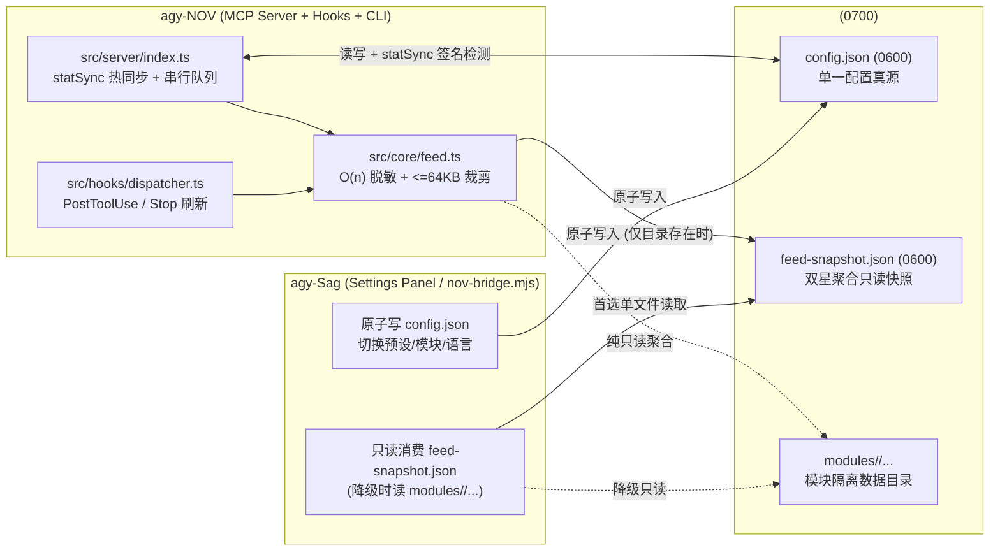

# agy-NOV × agy-Sag 双星零端口文件契约（v0.7.0）

本文档定义 `agy-NOV` 与 `agy-Sag` 之间的零重叠、零端口、纯文件原子协作契约，涵盖配置真源 `config.json`、聚合只读快照 `feed-snapshot.json`、全部 `modules/<id>/` 标准落盘路径，以及 `agy-Sag/cli/nov-bridge.mjs` 的精确路径修补指引。

## 1. 协作基线与安全红线

- **零新增端口 / 零 CDP / 零 ASAR**：双星间全部状态同步通过 `<NOV_DATA_DIR>` 下的受限权限文件完成，禁止开放额外本地监听端口或注入宿主进程。
- **缺失目录严格零触碰**：当 `<NOV_DATA_DIR>` 尚未创建时，所有只读查询、轮询器、`buildFeedSnapshot`、`PreInvocation` Hook 及 CLI `statusline` / `doctor` 均保持零目录创建与零文件写入。
- **原子写入与权限**：持久化写入统一采用目录 `0700`、临时文件 `0600` + 同目录 `fs.renameSync` 原子替换，避免并发读取半截 JSON。
- **防符号链接逃逸与原型链污染**：读写前须执行 `lstatSync` 检查（拒绝符号链接与非普通文件），解析 JSON 时拒绝 `__proto__`、`constructor`、`prototype` 等危险键。
- **严格脱敏**：`feed-snapshot.json` 与所有摘要输出均经线性时间 $O(n)$ 脱敏管线过滤，禁止携带 API Key、Token、Bearer/Basic 凭据、JWT、Webhook URL、PEM 私钥、配对码、环境变量值或 `<private>` 内容。



## 2. `<NOV_DATA_DIR>` 解析优先级

双星双方按完全一致的顺序解析数据根目录，且自动过滤未展开的模板占位符（如 `${PLUGIN_DATA}`）：

1. 显式参数：`--data-dir=<dir>`（Hook 分发器在 `--data-dir` 为占位符时回退至 stdin `payload.pluginData`）
2. 环境变量：`AGY_NOV_DATA_DIR`
3. 宿主插件变量：`PLUGIN_DATA`
4. 默认路径：`~/.agy-nov-data`

## 3. `config.json` 配置契约（单一真源）

路径：`<NOV_DATA_DIR>/config.json`（权限 `0600`）。

### 3.1 Schema（`schemaVersion: 1`）

```json
{
  "schemaVersion": 1,
  "preset": "core",
  "modules": {
    "review": true,
    "guard": true,
    "xray": true,
    "turbo": false,
    "radar": false,
    "verify": false,
    "worktree": false,
    "spec": false,
    "studio": false,
    "canvas": false,
    "mem": false,
    "ops": false,
    "remote": false
  },
  "defaultTab": "review",
  "startupView": "hub",
  "locale": "auto",
  "updatedAt": "2026-11-27T09:00:00.000Z"
}
```

| 字段 | 类型 | 说明 |
| --- | --- | --- |
| `schemaVersion` | `1` | 固定主版本号 |
| `preset` | `'core' \| 'power' \| 'local-all' \| 'full' \| 'minimal' \| 'custom'` | 由 `modules` 布尔表自动推导或显式应用 |
| `modules` | `Record<ModuleId, boolean>` | 13 个模块的布尔开关，缺失键按 `core` 默认补齐 |
| `defaultTab` | `ModuleId` | 默认激活模块页签（须为已启用且拥有 UI 的模块） |
| `startupView` | `'hub' \| 'last'` | 启动落点视图，默认 `'hub'` |
| `locale` | `'auto' \| 'en' \| 'zh-CN' \| 'zh-TW' \| 'ja' \| 'ko' \| 'es' \| 'fr' \| 'de'` | 界面语言偏好 |
| `updatedAt` | ISO-8601 string | 最近持久化时间 |

### 3.2 热同步机制

- `agy-NOV` MCP 服务每 `1500ms`（可通过 `--config-poll-ms` 覆盖）对 `config.json` 执行只读 `statSync`，计算签名 `${st.ino}:${st.mtimeMs}:${st.size}`。
- 签名未变时立即返回；遇到写入中的残缺 JSON 直接忽略并保留当前运行态；有效变更通过串行变更队列执行差量 `syncToolVisibility`、`syncModuleRuntimes`、通知订阅者，并同步刷新 `feed-snapshot.json`。
- 任何配置导入操作（如 `nov_app_import_config`）强制保持 `remote: false` 并发出告警提示，确保联网能力仅由用户显式手动开启。

## 4. `feed-snapshot.json` 双星只读聚合快照契约

路径：`<NOV_DATA_DIR>/feed-snapshot.json`（权限 `0600`，硬体上限 `<= 65,536` 字节 / `64 KiB`）。

### 4.1 写入与读取保证

- `buildFeedSnapshot(rootDataDir, config, options?)`：100% 纯只读内存聚合，绝不创建目录或写盘，读取各 `modules/<id>/` 文件时跳过符号链接与超限文件（> 2 MiB）。
- `writeFeedSnapshotIfDataDirExists(rootDataDir, config, options?)`：通过 `lstatSync(rootDataDir)` 确认目录已存在且为真实目录、目标文件非符号链接后才执行原子写入；目录缺失时返回 `false` 且零写盘。
- 触发时机：`agy-NOV` 配置变更（模块切换、预设、语言、启动视图、导入、重置、外部热同步）及 `PostToolUse` / `Stop` Hook 末尾 best-effort 刷新。

### 4.2 完整 Schema（`schemaVersion: 1`）

```json
{
  "schemaVersion": 1,
  "version": "0.7.0",
  "generatedAt": "2026-11-27T09:00:00.000Z",
  "preset": "core",
  "locale": "auto",
  "startupView": "hub",
  "enabledCount": 3,
  "totalModules": 13,
  "exposedModelTools": 12,
  "toolBudgetLimit": 100,
  "modules": {
    "review": true,
    "guard": true,
    "xray": true,
    "turbo": false,
    "radar": false,
    "verify": false,
    "worktree": false,
    "spec": false,
    "studio": false,
    "canvas": false,
    "mem": false,
    "ops": false,
    "remote": false
  },
  "paths": {
    "configFile": "config.json",
    "feedFile": "feed-snapshot.json",
    "modulesRoot": "modules",
    "moduleFiles": {
      "opsPrompts": "modules/ops/prompts.json",
      "guardAudit": "modules/guard/audit.json",
      "radarCapsule": "modules/radar/status-capsule.json",
      "memStore": "modules/mem/memories.json",
      "specState": "modules/spec/state.json",
      "verifyState": "modules/verify/state.json",
      "xrayLive": "modules/xray/live-state.json"
    }
  },
  "summary": {
    "guard": {
      "enabled": true,
      "blockedCount": 1,
      "askCount": 0,
      "lastEvent": {
        "decision": "deny",
        "toolName": "read_file",
        "reason": "Blocked access to .env",
        "timestamp": "2026-11-27T08:59:00.000Z"
      }
    },
    "spec": {
      "enabled": false,
      "activeSpecId": null,
      "title": null,
      "status": null,
      "writeLockActive": false,
      "doneTasks": 0,
      "totalTasks": 0,
      "readyTasks": 0
    },
    "verify": {
      "enabled": false,
      "enforceOnStop": false,
      "lastStatus": "idle",
      "dirtyFilesCount": 0
    },
    "mem": {
      "enabled": false,
      "totalMemories": 0,
      "staleCount": 0
    },
    "radar": {
      "enabled": false,
      "runningCount": 0,
      "awaitingCount": 0,
      "stalledCount": 0,
      "unreadCount": 0
    },
    "xray": {
      "enabled": true,
      "activeModel": "gemini-2.5-pro",
      "peakContextTokens": 48200,
      "estimatedCostUsd": 0.28
    },
    "turbo": {
      "enabled": false
    },
    "remote": {
      "enabled": false,
      "running": false
    }
  },
  "alerts": [
    {
      "level": "danger",
      "moduleId": "guard",
      "code": "GUARD_BLOCKED",
      "message": "Guard blocked 1 risky tool call(s): Blocked access to .env"
    }
  ]
}
```

### 4.3 告警分级与预算策略

`alerts` 最多包含 6 条按 `danger > warn > info` 排序的高信号告警：

| `code` | 级别 | 触发条件 |
| --- | --- | --- |
| `GUARD_BLOCKED` | `danger` | `guard` 开启且 `blockedCount > 0` |
| `VERIFY_STOP_BLOCKED` | `danger` | `verify` 开启且最近一次状态为 `blocked` |
| `VERIFY_CHECK_FAILED` | `warn` | `verify` 开启且最近一次状态为 `fail` |
| `SPEC_WRITE_LOCK` | `warn` | `spec` 开启且活跃 Spec 处于 `draft` 并启用 `enforcePlanBeforeWrite` |
| `MEM_STALE_DRIFT` | `warn` | `mem` 开启且存在 `staleCount > 0` 条漂移或失效锚点记忆 |
| `TOOL_BUDGET_HIGH` | `warn` / `danger` | 暴露工具数 `>= 75`（`>= 90` 升为 `danger`） |
| `RADAR_ATTENTION` | `info` | `radar` 开启且存在等待审批或停滞会话 |

## 5. 全量 `modules/<id>/` 标准路径表

所有模块数据严格归置于 `<NOV_DATA_DIR>/modules/<moduleId>/` 下（由 `getModuleDataDir(rootDataDir, moduleId)` 统一生成）。关闭状态的模块严禁创建其子目录。

| 模块 ID | 目录 | 标准文件 | 备注 |
| --- | --- | --- | --- |
| `review` | `modules/review/` | `review-signal.json`、`sessions/<repoKey>.json` | Hook 编辑信号与仓库批注 |
| `guard` | `modules/guard/` | `policy.json`、`audit.json`、`snapshots.json`、`blobs/<sha256>.blob` | 安全策略、拦截审计与编辑前快照 |
| `xray` | `modules/xray/` | `live-state.json` | 实时会话与工具热点钩子状态 |
| `turbo` | `modules/turbo/` | `stats.json` | RTK 压缩增益统计（SessionStart 保持纯只读） |
| `radar` | `modules/radar/` | `board.json`、`status-capsule.json` | 多会话看板与精简状态胶囊 |
| `verify` | `modules/verify/` | `state.json` | Stop 门禁策略、脏文件与验证证据链 |
| `worktree` | `modules/worktree/` | 无常驻写盘 | 直接基于 Git worktree 工作区只读/受控操作 |
| `spec` | `modules/spec/` | `state.json` | Spec 文档、写锁标记与 Task DAG 状态 |
| `studio` | `modules/studio/` | 无常驻写盘 | 按需只读解析工作区本地数据与环回探针 |
| `canvas` | `modules/canvas/` | `boards/<boardId>.json` | 沙盒画板与视觉批注 |
| `mem` | `modules/mem/` | `memories.json` | 代码锚点长期记忆库 |
| `ops` | `modules/ops/` | `prompts.json` | 参数化 Prompt 库（预算审计为纯只读） |
| `remote` | `modules/remote/` | `config.json`、`runtime.json` | 默认关闭；开启后才落盘配置与运行态 |

## 6. `agy-Sag/cli/nov-bridge.mjs` 精确修补指引

经核对，当前 `agy-Sag/cli/nov-bridge.mjs` 读取模块子文件时遗漏了 `modules/` 目录层级，导致在标准安装路径下无法命中真实文件：

### 6.1 缺陷定位

1. **`readNovOpsTemplates()`**
   - 现状：`const opsDir = path.join(paths.dataDir, 'ops');` -> 读取 `<dataDir>/ops/prompts.json`。
   - 标准路径：`<dataDir>/modules/ops/prompts.json`（即 `feed-snapshot.json` 中的 `paths.moduleFiles.opsPrompts`）。
2. **`NOV_FEED_FILES` 与 `readNovFeed()`**
   - 现状：`NOV_FEED_FILES` 使用 `['guard', 'audit.json']`、`['guard', 'snapshots.json']`、`['radar', 'status-capsule.json']`、`['mem', 'memories.json']`、`['spec', 'state.json']`，并交由 `readSafeNovSubJson(paths.dataDir, homeDir, subDir, fileName)` 直接拼接 `<dataDir>/<subDir>/<fileName>`。
   - 标准路径：全部位于 `<dataDir>/modules/<moduleId>/<fileName>` 下。

### 6.2 推荐修补方案（双层消费 + 向后安全）

1. **优先单文件消费 `feed-snapshot.json`**：
   - 在 `computeNovFeedSignature()` 与 `readNovFeed()` 中优先检查 `<dataDir>/feed-snapshot.json`（执行 `lstatSync` 非符号链接检查 + `<= 64 KiB` 体积检查 + 禁止原型污染键 + 校验 `schemaVersion === 1`）。
   - 命中有效 `feed-snapshot.json` 时直接返回其 `summary`、`alerts`、`exposedModelTools` 与 `paths`，实现单次只读 I/O 与天然脱敏。
2. **修补 `ops/prompts.json` 与降级回退路径**：
   - 将 `readNovOpsTemplates()` 中的 `opsDir` 修正为 `path.join(paths.dataDir, 'modules', 'ops')`（且对 `modules` 与 `modules/ops` 逐级执行 `findSymlinkViolation` / `safeLstat` 校验）。
   - 将 `readSafeNovSubJson()` 的基础目录修正为 `path.join(dataDir, 'modules', subDir)`（或直接接受相对路径如 `'modules/guard'`），确保在 `feed-snapshot.json` 尚未生成的冷启动场景下，依然能准确只读 `modules/{guard,radar,mem,spec,verify,xray}/...`。
3. **保持 `config.json` 同步字段对齐**：
   - `agy-Sag` 读写 `<dataDir>/config.json` 时保留 `startupView` 字段（默认 `'hub'`），避免在回写 `config.json` 时覆盖用户在 `agy-NOV` 设置中心选择的启动视图偏好。
