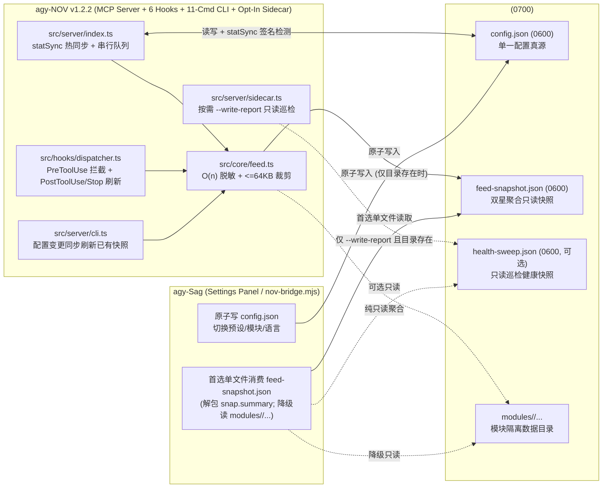

# agy-NOV × agy-Sag 双星零端口文件契约（v1.2.2）

本文档定义 `agy-NOV` 与 `agy-Sag` 之间的零重叠、零端口、纯文件原子协作契约，涵盖 `<NOV_DATA_DIR>` 跨客户端探测、配置真源 `config.json`、聚合只读快照 `feed-snapshot.json`、可选只读巡检快照 `health-sweep.json`、全部 `modules/<id>/` 标准落盘路径，以及 `agy-Sag` 联机接入核查要点。

## 1. 协作基线与安全红线

- **零新增端口 / 零 CDP / 零 ASAR**：双星间全部状态同步通过 `<NOV_DATA_DIR>` 下的受限权限文件完成，禁止开放额外本地监听端口或注入宿主进程。
- **缺失目录严格零触碰**：当 `<NOV_DATA_DIR>` 尚未创建时，所有只读查询、轮询器、`buildFeedSnapshot`、`PreInvocation` / `PostInvocation` Hook、只读 Sidecar 与 CLI `statusline` / `doctor` / `audit-once` 均保持零目录创建与零文件写入。
- **关闭模块严格零写入、零误报**：模块关闭后，模型工具与写操作 `app_*` 工具同步停用；跨模块写入（如 `spec -> mem` 归档）实时校验 `cfg.modules.mem`；`PreToolUse` / `PostToolUse` / `PostInvocation` Hook 与 `sidecar` 巡检均按开启状态门控。
- **原子写入与权限**：持久化写入统一采用目录 `0700`、临时文件 `0600` + 同目录 NTFS 重试原子替换 `atomicRenameSync`，避免并发读取半截 JSON。
- **防符号链接逃逸与原型链污染**：读写前须执行 `lstatSync` + 规范化路径边界检查（兼容 Windows `\\?\` 与 Linux 系统软链白名单，拒绝普通目录逃逸与符号链接），解析 JSON 时拒绝 `__proto__`、`constructor`、`prototype` 等危险键。
- **严格脱敏**：`feed-snapshot.json`、`health-sweep.json` 与所有摘要输出均经统一 `src/core/sanitize.ts` 线性时间 $O(n)$ 脱敏管线过滤，禁止携带 API Key、Token、Bearer/Basic 凭据、JWT、Webhook URL、PEM 私钥、配对码、环境变量值或 `<private>` 内容。



## 2. `<NOV_DATA_DIR>` 解析优先级（跨端、跨客户端一致）

双星双方按完全一致的顺序解析数据根目录，且自动过滤未展开的模板占位符（如 `${PLUGIN_DATA}`）：

1. 显式参数：`--data-dir=<dir>`（Hook 分发器在 `--data-dir` 为占位符时回退至 stdin `payload.pluginData`）
2. 环境变量：`AGY_NOV_DATA_DIR`
3. 宿主插件变量：`PLUGIN_DATA`
4. 只读探测已存在的官方宿主插件数据目录（按 `src/core/config.ts` `detectExistingOfficialPluginDataDir` 顺序，仅校验该目录已存在且为真实非软链目录，绝不创建）：
   - 通用 3 路径（macOS / Linux / Windows）：`~/.gemini/antigravity/plugin_data/agy-nov`、`~/.gemini/antigravity-cli/plugin_data/agy-nov`、`~/.gemini/antigravity-ide/plugin_data/agy-nov`
   - Linux XDG 扩展（`$XDG_DATA_HOME` 非空时）：`$XDG_DATA_HOME/gemini/antigravity/plugin_data/agy-nov`、`$XDG_DATA_HOME/gemini/antigravity-cli/plugin_data/agy-nov`、`$XDG_DATA_HOME/gemini/antigravity-ide/plugin_data/agy-nov`
   - Windows AppData 扩展（**先 `%LOCALAPPDATA%` 后 `%APPDATA%`**）：`%LOCALAPPDATA%\gemini\antigravity{,-cli,-ide}\plugin_data\agy-nov`、`%APPDATA%\gemini\antigravity{,-cli,-ide}\plugin_data\agy-nov`
5. 默认回退路径：`~/.agy-nov-data`

## 3. `config.json` 配置契约（单一真源）

路径：`<NOV_DATA_DIR>/config.json`（权限 `0600`）。

### 3.1 Schema（`schemaVersion: 1`）

```json
{
  "schemaVersion": 1,
  "preset": "core",
  "modules": {
    "review": true,
    "guard": true,
    "xray": true,
    "turbo": false,
    "radar": false,
    "verify": false,
    "worktree": false,
    "spec": false,
    "studio": false,
    "canvas": false,
    "mem": false,
    "ops": false,
    "remote": false
  },
  "defaultTab": "review",
  "startupView": "hub",
  "locale": "auto",
  "updatedAt": "2026-11-28T12:00:00.000Z"
}
```

| 字段 | 类型 | 说明 |
| --- | --- | --- |
| `schemaVersion` | `1` | 固定主版本号 |
| `preset` | `'core' \| 'power' \| 'local-all' \| 'full' \| 'minimal' \| 'custom'` | 由 `modules` 布尔表自动推导或显式应用 |
| `modules` | `Record<ModuleId, boolean>` | 13 个模块的布尔开关，缺失键按 `core` 默认补齐 |
| `defaultTab` | `ModuleId` | 默认激活模块页签（须为已启用且拥有 UI 的模块） |
| `startupView` | `'hub' \| 'last'` | 启动落点视图，默认 `'hub'`（外部回写 `config.json` 时须原样保留） |
| `locale` | `'auto' \| 'en' \| 'zh-CN' \| 'zh-TW' \| 'ja' \| 'ko' \| 'es' \| 'fr' \| 'de'` | 8 语种界面语言偏好 |
| `updatedAt` | ISO-8601 string | 最近持久化时间 |

### 3.2 热同步机制

- `agy-NOV` MCP 服务每 `1500ms`（可通过 `--config-poll-ms` 覆盖）对 `config.json` 执行只读 `statSync`，计算签名 `${st.ino}:${st.mtimeMs}:${st.size}`。
- 签名未变时立即返回；遇到写入中的残缺 JSON 直接忽略并保留当前运行态；有效变更通过串行变更队列执行差量 `syncToolVisibility`、`syncModuleRuntimes`、通知订阅者，并同步刷新 `feed-snapshot.json`。
- `agy-nov` CLI 执行 `enable` / `disable` / `preset` / `locale` 写盘 `config.json` 后，若 `<NOV_DATA_DIR>/feed-snapshot.json` 已存在且非软链，同步即时刷新该快照（消除离线改配置与快照分叉）。
- 任何配置导入操作（如 `nov_app_import_config`）强制保持 `remote: false` 并发出告警提示，确保联网能力仅由用户显式手动开启。

## 4. `feed-snapshot.json` 双星只读聚合快照契约

路径：`<NOV_DATA_DIR>/feed-snapshot.json`（权限 `0600`，硬体上限 `<= 65,536` 字节 / `64 KiB`）。

### 4.1 写入与读取保证

- `buildFeedSnapshot(rootDataDir, config, options?)`：100% 纯只读内存聚合，绝不创建目录或写盘，读取各 `modules/<id>/` 文件时跳过符号链接与超限文件（`> 2 MiB`）。
- `writeFeedSnapshotIfDataDirExists(rootDataDir, config, options?)`：通过 `lstatSync(rootDataDir)` 确认目录已存在且为真实目录、目标文件非符号链接后才执行原子写入；目录缺失时返回 `false` 且零写盘；内置忽略 `generatedAt` 的 SHA-256 语义脏检查与可选 `minIntervalMs` 合并窗（无变化自动跳过重写，杜绝高频写盘风暴）。
- 触发时机：
  1. `agy-NOV` MCP Server 配置变更（模块切换、预设、语言、启动视图、导入、重置、外部热同步）；
  2. `PreToolUse` Hook 返回 `deny`、`force_ask` 或 `ask` 之前即时刷新；
  3. `PostToolUse`（3 秒合并窗防写放大）与 `Stop` Hook 末尾 best-effort 刷新；
  4. `agy-nov` CLI `enable` / `disable` / `preset` / `locale` 写盘后刷新已存在的 `feed-snapshot.json`。

### 4.2 完整嵌套 Schema（`schemaVersion: 1`，`version: "1.2.2"`）

> **重要**：全部模块摘要位于顶层 **`summary.*`** 嵌套对象内（消费端应先解包 `const s = snap.summary ?? snap;`）。

```json
{
  "schemaVersion": 1,
  "version": "1.2.2",
  "generatedAt": "2026-11-28T12:00:00.000Z",
  "preset": "local-all",
  "locale": "zh-CN",
  "startupView": "hub",
  "enabledCount": 12,
  "totalModules": 13,
  "exposedModelTools": 43,
  "toolBudgetLimit": 100,
  "modules": {
    "review": true,
    "guard": true,
    "xray": true,
    "turbo": true,
    "radar": true,
    "verify": true,
    "worktree": true,
    "spec": true,
    "studio": true,
    "canvas": true,
    "mem": true,
    "ops": true,
    "remote": false
  },
  "paths": {
    "configFile": "config.json",
    "feedFile": "feed-snapshot.json",
    "modulesRoot": "modules",
    "moduleFiles": {
      "opsPrompts": "modules/ops/prompts.json",
      "guardAudit": "modules/guard/audit.json",
      "radarCapsule": "modules/radar/status-capsule.json",
      "memStore": "modules/mem/memories.json",
      "specState": "modules/spec/state.json",
      "verifyState": "modules/verify/state.json",
      "xrayLive": "modules/xray/live-state.json"
    }
  },
  "summary": {
    "guard": {
      "enabled": true,
      "blockedCount": 1,
      "askCount": 2,
      "forceAskCount": 1,
      "permissionMode": "strict-gate",
      "snapshotCount": 3,
      "latestSnapshotId": "snap_20261128_003",
      "lastEvent": {
        "decision": "force_ask",
        "toolName": "write_file",
        "reason": "Strict gate requires explicit user confirmation",
        "timestamp": "2026-11-28T11:59:30.000Z"
      }
    },
    "spec": {
      "enabled": true,
      "activeSpecId": "spec-auth-v2",
      "title": "OAuth2 Token Rotation",
      "status": "draft",
      "writeLockActive": true,
      "doneTasks": 1,
      "totalTasks": 3,
      "readyTasks": 1
    },
    "verify": {
      "enabled": true,
      "enforceOnStop": true,
      "lastStatus": "blocked",
      "dirtyFilesCount": 2
    },
    "mem": {
      "enabled": true,
      "totalMemories": 8,
      "staleCount": 1
    },
    "radar": {
      "enabled": true,
      "runningCount": 2,
      "awaitingCount": 1,
      "stalledCount": 0,
      "unreadCount": 1
    },
    "xray": {
      "enabled": true,
      "activeModel": "gemini-2.5-pro",
      "peakContextTokens": 48200,
      "estimatedCostUsd": 0.28
    },
    "turbo": {
      "enabled": true
    },
    "remote": {
      "enabled": false,
      "running": false
    }
  },
  "alerts": [
    {
      "level": "danger",
      "moduleId": "guard",
      "code": "GUARD_BLOCKED",
      "message": "Guard blocked 1 risky tool call(s): Blocked access to .env"
    },
    {
      "level": "danger",
      "moduleId": "verify",
      "code": "VERIFY_STOP_BLOCKED",
      "message": "Stop Gate blocked completion (2 dirty file(s) unverified)"
    },
    {
      "level": "warn",
      "moduleId": "spec",
      "code": "SPEC_WRITE_LOCK",
      "message": "Spec draft write-lock active: OAuth2 Token Rotation"
    },
    {
      "level": "warn",
      "moduleId": "mem",
      "code": "MEM_STALE_DRIFT",
      "message": "1 anchored memory item(s) drifted after file edits"
    },
    {
      "level": "info",
      "moduleId": "radar",
      "code": "RADAR_ATTENTION",
      "message": "Radar: 1 session(s) awaiting approval, 0 stalled"
    }
  ]
}
```

### 4.3 关键字段语义与排序约定（v1.2.1+ 固化）

- `summary.guard`：
  - `blockedCount`：最近 200 条审计记录中 `decision` 为 `deny` 或 `blocked` 的次数；
  - `askCount`：`decision` 为 `ask` 或 `force_ask` 的总次数；`forceAskCount` 单独统计 `force_ask` 次数；
  - `permissionMode`：来自 `modules/guard/policy.json`，取值 `'readonly-audit' | 'balanced-dev' | 'strict-gate'`；
  - `snapshotCount` 与 `latestSnapshotId`：按 `createdAt ?? timestamp` 最大有效时间戳选取最新快照（`snapshots.json` 内部按最新在前 `[0]` 存储）；
  - `lastEvent`：始终使用规范字段名 `{ decision, toolName, reason, timestamp }`（对应 `modules/guard/audit.json` 的最新条目 `[0]`，其中原始文件原因字段为 `summary`）；
  - `GUARD_BLOCKED` 告警文案始终引用最近一条真实 `deny`/`blocked` 事件的拦截原因，不会被后续 `force_ask`/`ask` 覆盖。
- `summary.verify`：
  - `lastStatus` 枚举为 `'pass' | 'fail' | 'blocked' | 'idle'`，按 `evidence` 数组中最大有效 `timestamp ?? createdAt` 选取最新记录（`state.json` 中最新记录默认位于 `[0]`）。
- `summary.spec`：
  - `writeLockActive` 为 `status === 'draft' && enforcePlanBeforeWrite === true`（仅草稿态且启用写前计划锁时生效）。
- `summary.mem`：
  - `staleCount` 统计顶层布尔 `stale === true || drifted === true`，或代码锚点 `driftStatus` 为 `'drifted'` 或 `'missing'` 的记忆条数（`CodeAnchor.driftStatus` 枚举为 `'fresh' | 'drifted' | 'missing' | 'untracked' | 'skipped'`）。

- `summary.remote`（v1.2.2 加固）：
  - `running` 在从 `modules/remote/runtime.json` 推导时，会对记录的 `pid` 执行只读 `isPidAlive` 判活（宿主 5 秒 `SIGKILL` 强杀残留的陈旧 `runtime.json` 不再误报 `running: true`）。

### 4.4 告警分级与预算策略

`alerts` 最多包含 6 条按 `danger > warn > info` 排序的高信号告警：

| `code` | 级别 | 触发条件 |
| --- | --- | --- |
| `GUARD_BLOCKED` | `danger` | `guard` 开启且 `blockedCount > 0` |
| `VERIFY_STOP_BLOCKED` | `danger` | `verify` 开启且最近一次状态为 `blocked` |
| `VERIFY_CHECK_FAILED` | `warn` | `verify` 开启且最近一次状态为 `fail` |
| `SPEC_WRITE_LOCK` | `warn` | `spec` 开启且活跃 Spec 处于 `draft` 并启用 `enforcePlanBeforeWrite` |
| `MEM_STALE_DRIFT` | `warn` | `mem` 开启且存在 `staleCount > 0` 条漂移或失效锚点记忆 |
| `TOOL_BUDGET_HIGH` | `warn` / `danger` | 暴露工具数 `>= 75`（`>= 90` 升为 `danger`） |
| `RADAR_ATTENTION` | `info` | `radar` 开启且存在等待审批或停滞会话 |

## 5. 可选只读巡检快照 `health-sweep.json`（v1.2.0+）

路径：`<NOV_DATA_DIR>/health-sweep.json`（权限 `0600`，硬上限 `<= 64 KiB`）。

- **默认不生成**：仅当用户显式运行 `agy-nov audit-once --write-report` 或启用只读 Sidecar `sidecars/audit-sidecar.mjs --write-report` 且 `<NOV_DATA_DIR>` 已存在安全真目录时才原子写入；
- **模块门控与语义脏检查（v1.2.1 / v1.2.2）**：巡检严格按 `config.json` 中 `mem`、`verify`、`guard` 开启状态门控，关闭的模块输出空态，避免残留历史文件触发误报；`writeHealthSweepReportIfPermitted` 内置忽略 `generatedAt` 的 SHA-256 语义脏检查，巡检结果无变化时自动跳过写盘；
- **只读消费约定**：`agy-Sag` 若需展示健康分，应与 `feed-snapshot.json` 一样先校验非符号链接、体积 `<= 64 KiB` 与无原型污染键，缺失时静默忽略。

## 6. 全量 `modules/<id>/` 标准路径与排序约定

所有模块数据严格归置于 `<NOV_DATA_DIR>/modules/<moduleId>/` 下（由 `getModuleDataDir(rootDataDir, moduleId)` 统一生成）。关闭状态的模块严禁创建其子目录。

| 模块 ID | 目录 | 标准文件 | 排序与字段备注 |
| --- | --- | --- | --- |
| `review` | `modules/review/` | `review-signal.json`、`sessions/<repoKey>.json` | Hook 编辑信号与仓库批注 |
| `guard` | `modules/guard/` | `policy.json`、`audit.json`、`snapshots.json`、`blobs/<sha256>.blob` | `audit.json` 与 `snapshots.json` 均为**最新在前 `[0]`**；`audit` 原字段为 `timestamp`/`toolName`/`summary`，`snapshots` 时间字段为 `createdAt` |
| `xray` | `modules/xray/` | `live-state.json` | 实时会话与工具热点钩子状态 |
| `turbo` | `modules/turbo/` | `stats.json`、`prefs.json`、`hotspots.json` | RTK 压缩增益、Auto-RTK 开关（默认 `false`）与高频热点（SessionStart 保持纯只读） |
| `radar` | `modules/radar/` | `board.json`、`status-capsule.json` | 多会话看板与精简状态胶囊（等待审批计数为 `counts.awaiting_approval`） |
| `verify` | `modules/verify/` | `state.json` | Stop 门禁策略、脏文件与验证证据链（按最新时间戳选取） |
| `worktree` | `modules/worktree/` | 无常驻写盘 | 直接基于 Git worktree 工作区只读/受控操作 |
| `spec` | `modules/spec/` | `state.json` | Spec 文档、写锁标记（`enforcePlanBeforeWrite`）与 Task DAG 状态 |
| `studio` | `modules/studio/` | 无常驻写盘 | 按需只读解析工作区本地数据与环回探针 |
| `canvas` | `modules/canvas/` | `boards/<boardId>.json` | 沙盒画板与视觉批注 |
| `mem` | `modules/mem/` | `memories.json` | 代码锚点长期记忆库（漂移态按顶层 `stale === true \|\| drifted === true` 或锚点 `driftStatus` 为 `'drifted'` / `'missing'` 判定；受 `cfg.modules.mem` 门控） |
| `ops` | `modules/ops/` | `prompts.json` | 参数化 Prompt 库（预算与安全审计为纯只读） |
| `remote` | `modules/remote/` | `config.json`、`runtime.json` | 默认关闭；开启后才落盘配置与运行态 |

## 7. `agy-Sag` 联机接入核查清单

伴侣仓 `agy-Sag` 在 `cli/nov-bridge.mjs` 与 UI 消费端接入时应核对以下要点（最新实测错位明细同步维护于 `agy-Sag/FROM_AGY_NOV.md`）：

1. **快路径解包 `snap.summary`**：读取 `feed-snapshot.json` 时先执行 `const s = snap.summary ?? snap;`，并透传 `s.xray` 与顶层 `startupView`。
2. **`guard.lastEvent` 字段兼容**：同时读取 `ev.timestamp ?? ev.ts`、`ev.toolName ?? ev.tool`、`ev.reason ?? ev.summary`。
3. **Verify 状态放行 `'blocked'`**：校验白名单与胶囊/设置页展示必须覆盖 `'pass' | 'fail' | 'blocked' | 'idle'`。
4. **降级回退顺序与语义一致**：读取 `modules/guard/{audit,snapshots}.json` 按最新时间戳（降序数组 `[0]`）取值；`spec.writeLockActive` 同时检查 `status === 'draft' && Boolean(enforcePlanBeforeWrite)`；`radar` 补读 `counts.awaiting_approval`；`mem` 按顶层 `stale === true || drifted === true` 及锚点 `driftStatus` 为 `'drifted'` / `'missing'` 统计 `staleCount`；降级文本补齐 `<private>` 剥离。
5. **保持 `config.json` 字段完整**：写回 `<NOV_DATA_DIR>/config.json` 时保留 `startupView` 字段，并与 `agy-NOV` 一致遵循第 2 节 `<NOV_DATA_DIR>` 探测顺序（含 `PLUGIN_DATA` 及多客户端 `plugin_data` 路径）。
