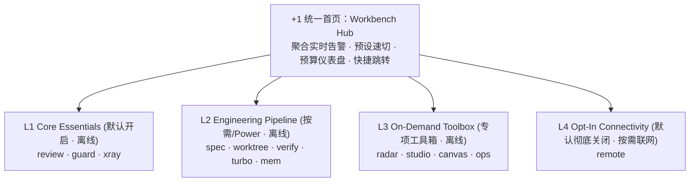

# agy-NOV 产品信息架构规范（v0.7.0）

本文档定义 `agy-NOV` 的产品信息架构（IA）、4+1 功能金字塔、宽窄双态导航模型、四级统一设置中心单一真源规范，以及零 Token `PreInvocation` 视觉回执机制。

## 1. 模块治理与架构准入原则

`agy-NOV` 当前采用 **4+1 功能金字塔** 清晰组织并管理现有的 13 个纯原生模块。模块清单保持开放演进，后续可随时依据真实用户刚需新增、合并或精简模块；任何新增或调整均须严格满足以下四条架构准入原则：

1. **归属清晰功能域**：每个模块明确归属 `core`、`pipeline`、`toolbox` 或 `connectivity` 四个域之一，避免功能职责重叠与心智负担扩散。
2. **单一真源开关**：所有模块开关、预设、语言与启动视图统一以 `<NOV_DATA_DIR>/config.json` 为单一真源，UI 设置中心、`agy-nov` CLI 与 `agy-Sag` 控制面板共享同一份原子状态。
3. **关闭态零开销**：关闭模块时，同步停用对应模型工具与写操作 `app_*` 工具；Hook 分发器在首行按只读配置完成 $O(1)$ 短路；关闭模块严禁创建子目录、写盘、启动轮询或发起网络请求。
4. **严控总工具预算**：总暴露工具数严格受控于 Antigravity 100 工具预算上限（当前满配 13 模块暴露 47 个模型工具，默认 `core` 预设仅 12 个工具），管理类与纯 UI 交互操作一律注册为 App-only（`visibility: ['app']`），做到零模型上下文膨胀。

## 2. 4+1 功能金字塔

“+1”代表统一指挥台 **Hub（工作台首页）**；“4”代表按使用频率、工作流闭环与网络隔离级别划分的四层功能域：



| 层级 | `domain` ID | 默认状态 | 包含模块 | 定位与工具开销 |
| --- | --- | --- | --- | --- |
| **+1** | `hub`（入口视图） | 默认首屏 | Hub 总览（只读聚合） | 一眼看清 Guard/Spec/Verify/Mem/Radar/X-Ray 信号与工具预算（0 模型工具） |
| **L1** | `core` | 默认开启 | `review`、`guard`、`xray` | 高频日常护栏、行级 Diff 审阅与上下文透视（共 10 模块工具 + 2 入口 = 12） |
| **L2** | `pipeline` | 默认关闭 | `spec`、`worktree`、`verify`、`turbo`、`mem` | 计划写锁 → 并行工作树 → 压缩检索 → 长期记忆 → Stop 门禁的工程闭环（共 18 工具） |
| **L3** | `toolbox` | 默认关闭 | `radar`、`studio`、`canvas`、`ops` | 多会话雷达、本地数据/文档/OpenAPI 工作室、视觉画板、Prompt 库与预算体检（共 13 工具） |
| **L4** | `connectivity` | 严格关闭 | `remote` | 手机 PWA 与 IM 审批/告警；仅在用户显式启用后才监听本地回环或外发通知（共 4 工具） |

### 预设档位与模型工具预算对照

| 预设 ID | 开启模块数 | 模型可见工具数 | 占 100 工具上限比例 | 网络隔离 |
| --- | --- | --- | --- | --- |
| `minimal` | 1（`guard`） | 6 | 6% | 100% 离线 |
| `core`（默认） | 3（L1 全部） | 12 | 12% | 100% 离线 |
| `power` | 9（离线主力研发流） | 32 | 32% | 100% 离线 |
| `local-all` | 12（全部离线模块） | 43 | 43% | 100% 离线 |
| `full` | 13（含 `remote`） | 47 | 47% | 按需联网（需显式选择） |

## 3. 宽窄双态导航规范

`agy-NOV` 同时运行于 Antigravity **侧边辅助面板（`aux_pane`，窄态）** 与 **全局独立面板（`global`，宽态）**，通过容器断点自适应切换导航结构，保持单一 Bundle（`dist/ui/app.html`）零重复代码：

- **固定一级导航入口**：
  - `hub`：工作台首页，聚合 `nov_app_get_hub_state` 返回的只读快照、高优先级告警与 `.agy-nov.json` 团队预设状态。
  - 已启用模块页签：按 `L1 -> L2 -> L3 -> L4` 域序展示，关闭模块自动退出导航栏，减少视觉噪音。
  - `settings`（兼容旧 `modules` 入口）：四级统一设置中心，收纳全部模块开关、预设、偏好与导入导出。
- **窄态（侧边栏 `< 760px`）**：
  - 顶部采用单行紧凑分段栏 + 下拉/抽屉模块切换器，将超过 90% 的可视面积让给当前活跃模块正文。
  - 告警条折叠为单行摘要胶囊，点击直接跳转对应模块（如 Spec 写锁、Verify 拦截或 Guard 审计）。
- **宽态（全局面板 `>= 760px`）**：
  - 左侧采用按 4 大功能域分组的导航轨（显示域标签与运行指示灯），右侧展开完整工作区视图。
  - Hub 首页以多列卡片网格呈现工具预算条、活跃告警列表、模块健康卡与一键预设切换。
- **启动落点策略（`startupView`）**：
  - `hub`（默认）：无参调用 `nov_open` 时打开 `hub` 首页，先看全局状态再进入目标模块。
  - `last`：无参调用 `nov_open` 时直接回到 `config.defaultTab`（最近活跃模块）。
  - 显式调用 `nov_open({ module })`（支持全部 13 个模块 ID 以及 `'hub'`、`'settings'`、`'modules'`）始终优先跳转到指定视图。

## 4. 四级统一设置中心单一真源规范

设置中心采用四级清晰分层，所有修改均通过后端串行变更队列原子写入 `<NOV_DATA_DIR>/config.json`，实时触发 MCP `tools/list_changed` 差量同步与 `feed-snapshot.json` 刷新：

| 分级 | 分区主题 | 对应 App-only 控制工具 | 核心约束 |
| --- | --- | --- | --- |
| **第 1 级** | 预设方案与工具预算 | `nov_app_apply_preset`、`nov_app_get_hub_state` | 实时显示当前暴露工具数 / 100 预算进度条与 `.agy-nov.json` 团队建议 |
| **第 2 级** | 分域模块开关矩阵 | `nov_app_set_module` | 按 4 大功能域分组展示 13 个模块开关、离线/联网标识与工具数；切换即生效 |
| **第 3 级** | 界面偏好与启动视图 | `nov_app_set_locale`、`nov_app_set_startup_view` | 支持 `auto` 及 8 种母语（EN/简体/繁體/日本語/한국어/ES/FR/DE）与 `hub`/`last` 启动视图 |
| **第 4 级** | 配置备份、迁移与重置 | `nov_app_export_config`、`nov_app_import_config`、`nov_app_reset_config` | 导出仅含白名单字段、零密钥零本机路径；导入严格限制 32 KiB、拦截原型链污染并强制保持 `remote: false`；重置须显式 `confirm: true` 回到默认 `core` |

所有 5 个新增管理控制工具（`nov_app_get_hub_state`、`nov_app_set_startup_view`、`nov_app_export_config`、`nov_app_import_config`、`nov_app_reset_config`）均标注 `_meta: { ui: { visibility: ['app'] } }`，模型上下文可见工具数严格维持 47 个不变。

## 5. `PreInvocation` 零 Token 原生视觉回执

`hooks.json` 接入 Antigravity 原生 `PreInvocation` 生命周期钩子，通过 `injectSteps[].systemMessage` 机制向用户界面呈现高信号只读回执，同时将 `systemMessage` 正文严格置为空字符串 `""`，做到 **零模型 Token 消耗、零阻断模型调用、零写盘**：

```json
{
  "injectSteps": [
    {
      "systemMessage": {
        "systemMessage": "",
        "metadata": {
          "user_markdown": "🔒 **Spec Write Lock**: \"Auth refactor\" is in DRAFT — approve before editing files."
        }
      }
    }
  ]
}
```

- **O(1) 短路**：当 `spec`、`mem`、`guard` 三个模块全部关闭时立即返回 `{}`，零磁盘读取。
- **三类高信号只读回执**：
  1. `spec` 开启且存在活跃 `DRAFT` 写锁 Spec → 提示需先审批 Spec 再修改文件。
  2. `mem` 开启且存在 `stale` / `drifted` 记忆条目 → 提示核对或重新校验代码锚点。
  3. `guard` 开启且最近 5 分钟内发生 `deny` 拦截 → 展示脱敏后的工具名与拦截原因摘要。
- **永不阻断**：`PreInvocation` 仅做透明可视化回执，绝不输出 `terminationBehavior: 'terminate'`，亦不创建任何目录或文件。
